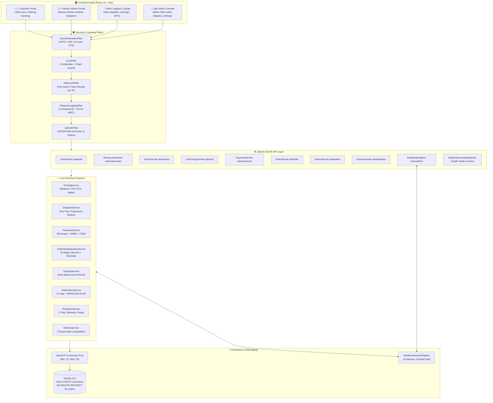

<div align="center">

# 🍽️ CravePulse
### India's Fair Food Delivery Network

**A production-grade, real-time multi-portal food delivery platform**
built from scratch with **zero frameworks** — no Spring Boot, no Hibernate, no Lombok.

[](https://openjdk.org/projects/jdk/17/)
[](https://react.dev/)
[](https://www.mysql.com/)
[](https://jakarta.ee/)
[](https://developer.mozilla.org/en-US/docs/Web/API/WebSocket)
[](https://opensource.org/licenses/MIT)

</div>

<div align="center">

[Frontend (vercel)](https://crave-pulse-xi.vercel.app/)
[Backend API (Render)](https://cravepulse-74ry.onrender.com/api/health)

</div>

---

## 🚀 What is CravePulse?

CravePulse is a **full-stack, real-time food delivery platform** that rethinks the gig-economy model with radical transparency. Unlike traditional food platforms that mark up restaurant menu prices, CravePulse enforces **100% dine-in price parity** — what you see on the restaurant's physical menu is exactly what you pay online.

Built with raw **Jakarta Servlets 6.0**, direct **JDBC PreparedStatements**, **HikariCP connection pooling**, and a **bidirectional Jakarta WebSocket** server — with no Spring Boot, no Hibernate, and no magic annotations — every byte of this platform is handcrafted and intentional.

---

## 🏗️ Architecture Overview



---

## ⚡ Core Technology Stack

| Layer | Technology | Why |
|---|---|---|
| **Backend Runtime** | Java 17 (Jakarta Servlets 6.0) | Zero-framework, full control over request lifecycle |
| **HTTP Server** | Embedded Apache Tomcat 10.1 | Packaged as fat-JAR, no external server needed |
| **Database** | MySQL 8.0 + HikariCP | Strict constraints, `SELECT ... FOR UPDATE` concurrency |
| **Data Access** | Raw JDBC PreparedStatements | No ORM overhead, full SQL control |
| **Real-Time** | Jakarta WebSocket (`@ServerEndpoint`) | Bidirectional push: orders, GPS, kitchen alerts, chat |
| **Security** | HMAC HS256 JWT + BCrypt | Token revocation table, role-scoped request guards |
| **Payments** | Razorpay HTTP API | Order creation, HMAC signature verification, webhook idempotency |
| **Frontend** | React 18 + Vite + Bootstrap 5 | SPA with code-split routes, lazy loading |
| **Maps** | Leaflet + OpenStreetMap | Open-source live rider telemetry GPS map |
| **Audio/Canvas** | Web Audio API + HTML5 Canvas | Kitchen order chime alerts, particle background effects |
| **Build** | Apache Maven 3.8 | Shade plugin → single executable fat-JAR |
| **Deployment** | Render (backend) + Vercel (frontend) + TiDB Cloud (DB) | Production cloud deployment |

---

## 📁 Project Structure

```
CravePulse/
├── backend/                          # Java 17 Maven backend
│   ├── src/main/java/com/foodplatform/
│   │   ├── config/                   # AppProperties, DatabaseConfig, MigrationRunner
│   │   ├── dao/                      # DAO interfaces (16 contracts)
│   │   ├── daoImpl/                  # JDBC implementations (16 files)
│   │   ├── filter/                   # Security, CORS, Rate Limit, JWT, Logging filters
│   │   ├── model/                    # 22 domain model POJOs
│   │   ├── service/                  # 11 business engines (Pricing, Dispatch, Payment...)
│   │   ├── servlet/                  # 17 Jakarta HTTP servlet endpoints
│   │   ├── util/                     # JWT, Password (BCrypt), JSON utilities
│   │   └── websocket/                # RealtimeEndpoint + SessionRegistry
│   └── src/main/resources/
│       └── db/migration/             # V1–V22 versioned SQL migrations
├── frontend/                         # React 18 + Vite frontend
│   └── src/
│       ├── components/               # 25+ reusable UI components
│       ├── context/                  # Auth, Cart, Realtime React contexts
│       ├── hooks/                    # useApi, useCheckout, useOrderTracking...
│       ├── pages/
│       │   ├── admin/                # 11 admin panel pages
│       │   ├── customer/             # 16 customer-facing pages
│       │   ├── partner/              # 6 kitchen partner pages
│       │   └── rider/                # 6 rider delivery pages
│       ├── services/                 # Axios API client + WebSocket client
│       └── theme/                    # Design tokens, portal CSS, variables
├── docs/                             # API, architecture, UI and operational documentation
├── scripts/
│   └── seed-demo.sql                 # 27 restaurants, menus, users, orders
├── docker-compose.yml
└── .env.example
```

---

## 🌟 Feature Implementation Matrix

### ✅ Implemented & Live

| Module | Feature | Details |
|---|---|---|
| **Auth & Security** | JWT HS256 Access + Refresh Tokens | Atomic DB revocation in `user_tokens` table |
| **Auth & Security** | Role-Based Access Control (RBAC) | `CUSTOMER`, `RESTAURANT_OWNER`, `RIDER`, `ADMIN` portal guards |
| **Auth & Security** | Token Bucket Rate Limiting | 100 req/min per IP in-memory |
| **Auth & Security** | Security Headers | HSTS, CSP, X-Frame-Options, XSS protection |
| **Auth & Security** | OTP Delivery Verification | 4-digit delivery OTP required before `DELIVERED` state |
| **Discovery** | Cross-Dish & Kitchen Search | SQL subqueries across menus + restaurant suggestions autocomplete |
| **Discovery** | Multi-City Location Picker | Pan-India coordinates + HTML5 Geolocation API |
| **Discovery** | **Price Parity Guarantee** | 100% dine-in price transparency badge on every dish |
| **Discovery** | **Swiggy & Zomato Card UX** | 16:10 aspect ratio image, gradient deal overlay, green rating pill (`★ 4.8`), interactive favorites |
| **Discovery** | **Horizontal Reviews Carousel** | Touch-swipe & keyboard snap carousel with live rating distribution and zero fake data |
| **Discovery** | Photo Cuisine Filters | Admin-managed cuisine categories with HTTPS food photography |
| **Discovery** | Paginated Restaurant Results | Server-backed offset/limit browsing with a load-more control |
| **Layout & Mobile** | **Responsive Primitives** | Fluid `clamp()` typography, `ResponsiveTable` (table → cards on mobile), safe-area insets |
| **Partner Portal** | **Mobile Single-Column Kanban** | Quick tab switcher on `< 768px` for one-thumb kitchen dispatch operations |
| **Real-Time** | **Live WebSocket & Offline Radar** | Navbar live status indicator dot and browser offline detection alert banner |
| **Ordering** | Item Customizer Modal | Portion variants, add-ons, special cooking instructions |
| **Ordering** | Single-Restaurant Cart Guard | Prevents mixed-kitchen cart with conflict modal |
| **Ordering** | Dynamic Coupon Engine | Min-order, first-order guard, usage caps, % and flat discounts |
| **Checkout** | 100% Tip Pass-Through | Zero platform commission on rider tips |
| **Checkout** | Itemised Bill Breakdown | GST, packaging, delivery, platform fee, wallet credit |
| **Payments** | Razorpay Online Payments | Order creation, HMAC signature verification, webhook idempotency |
| **Payments** | In-App CravePulse Wallet | Atomic double-entry debit/credit ledger |
| **Payments** | Cash On Delivery (COD) | Platform ceiling limit check (₹2000 default) |
| **Real-Time** | 9-Stage Order State Machine | PLACED → ACCEPTED → PREPARING → READY → PICKED_UP → DELIVERED → REFUNDED |
| **Real-Time** | Live Rider GPS Telemetry Map | Leaflet OpenStreetMap with WebSocket GPS pings |
| **Real-Time** | In-App Order Chat | Order-scoped bidirectional messaging between customer & rider |
| **Real-Time** | Masked Calling Proxy | Platform phone dialers to protect user identity |
| **Partner Portal** | Kitchen Kanban Board | Web Audio API chime alerts, prep-time confirmation, SLA countdown |
| **Partner Portal** | Full Menu Management | CRUD for items, variants, add-ons, bulk sold-out toggle, soft delete |
| **Partner Portal** | Settlement Ledger | Gross sales, commission deductions, GST breakdowns, UTR references |
| **Partner Portal** | Food Analytics Dashboard | Sales trends, top dishes, revenue charts |
| **Rider Portal** | Fair-Pay Dispatch Protocol | Upfront transparent earning breakdown before accepting a job |
| **Rider Portal** | Wait-Time Compensation | ₹2/min credited for restaurant delays > 8 minutes |
| **Rider Portal** | COD Cash Settlement Ledger | Running cash-in-hand tracking and platform deposit records |
| **Rider Portal** | Sequential Rider Dispatch | Nearest eligible rider first; timeout/rejection advances the offer, with progressive radius expansion |
| **Admin Console** | Live Fleet & Order Radar | Real-time GPS map of all online riders and active dispatches |
| **Admin Console** | User Directory & Suspension | Account moderation + fraud risk escalation counters |
| **Admin Console** | Rule-Based Dispute Engine | Auto-refund caps, 2-hour window rule, fraud flag evaluation |
| **Admin Console** | Platform Levers & CSV Export | Live-tunable fees, GST, search radius, RFC-4180 streaming exports |
| **Admin Console** | Audit Log Trail | Every admin action logged with actor, target, IP, and timestamp |
| **Admin Console** | Cuisine Category Management | Create, edit, reorder, hide, and restore customer cuisine filters |
| **Admin Console** | Persisted Partner Approvals | KYC approval/revocation updates profile and account status transactionally; partners receive an in-app notice with the admin note |
| **Database** | V1–V22 Versioned Migrations | Versioned SQL applied on server startup; existing migration files must remain immutable |
| **Database** | Strict Constraints | MySQL 8 `CHECK` constraints, non-cascade FKs, pessimistic locking |
| **Database** | 7-Day Telemetry Retention | Scheduled purge of GPS logs and stale dispatch records |
| **Observability** | Structured Request IDs | `X-Request-ID` propagation through all SLF4J MDC logs |
| **Observability** | Health & Readiness Probes | `/health`, `/ready`, `/metrics` endpoints for Render deployment |

---

## 🔮 Planned Future Features (Roadmap)

These features are researched, designed, and queued for implementation in upcoming versions:

### 🚀 Version 1.1 — Smart Ordering Experience

| Feature | Description |
|---|---|
| **AI-Powered Dish Recommendations** | Personalized dish suggestions based on order history, time of day, weather, and cuisine preference using collaborative filtering |
| **Scheduled / Pre-Orders** | Book an order up to 7 days in advance with a scheduled delivery time slot |
| **Group Ordering with Split Bill** | Multiple users contribute items to a shared cart; split by equal or custom percentage |
| **Voice Search for Dishes** | Browser Web Speech API integration for hands-free dish and restaurant discovery |
| **Smart Reorder** | One-tap reorder of last or most-frequently ordered meals |

### 💰 Version 1.2 — Advanced Payments & Finance

| Feature | Description |
|---|---|
| **UPI AutoPay Subscriptions** | Monthly meal plan subscriptions with auto-debit via UPI mandate |
| **BNPL (Buy Now Pay Later)** | Integration with LazyPay or Simpl for deferred payment on high-value orders |
| **Multi-Currency Support** | Support for international customers using USD, GBP, AED with live forex conversion |
| **Cashback & Loyalty Points** | Earn CraveCoins on every order, redeem on wallet top-ups or future orders |
| **Partner Revenue Advance** | Restaurant partners request revenue advances against upcoming settlements |

### 📍 Version 1.3 — Hyperlocal & Logistics

| Feature | Description |
|---|---|
| **Real-Time Route Optimization** | Dynamic OSRM/Mapbox routing to calculate optimal delivery path |
| **Surge Pricing Engine** | Dynamic delivery fee adjustment based on demand density and weather |
| **Multi-Stop Delivery (Batch Orders)** | One rider delivers up to 3 orders per trip with optimized stop sequencing |
| **Dark Store Integration** | Instant grocery delivery from micro-warehouses alongside restaurant orders |
| **Hyperlocal Zone Management** | Admin-configurable delivery zones with polygon-based geofencing |

### 🌍 Version 1.4 — Scale & Localization

| Feature | Description |
|---|---|
| **Multi-Language UI** | Full localization for Hindi, Telugu, Kannada, and Tamil using i18n |
| **Accessibility (WCAG 2.1 AA)** | Screen reader support, keyboard navigation, high-contrast mode |
| **PWA / Installable App** | Progressive Web App manifest, offline support, push notifications via Service Worker |
| **Regional Cuisine Expansion** | Curated south Indian, street food, and regional thali category pages |
| **SMS Order Alerts** | Twilio/Exotel SMS fallback for users without internet connectivity |

### 🛡️ Version 1.5 — Enterprise & Compliance

| Feature | Description |
|---|---|
| **Redis WebSocket Backplane** | Replace in-memory `RealtimeSessionRegistry` with Redis Pub/Sub for multi-node horizontal scaling |
| **FSSAI License Verification API** | Auto-validate restaurant FSSAI license numbers via government API |
| **GDPR / DPDP Compliance Module** | User data export, right-to-erasure, consent management dashboard |
| **AI Fraud Detection** | ML model to detect fraudulent dispute patterns, fake reviews, and account abuse |
| **Franchising / Cloud Kitchen Network** | Single brand operating from multiple kitchen nodes across cities |

### 📊 Version 1.6 — Analytics & Intelligence

| Feature | Description |
|---|---|
| **Demand Forecasting Dashboard** | Restaurant partners see predicted order volume per hour/day using historical data |
| **Customer Lifetime Value (CLV) Engine** | Segment customers by LTV for targeted retention campaigns |
| **Real-Time Sales Heatmap** | Admin sees an interactive city-wide heatmap of order density and kitchen load |
| **Rider Performance Scorecard** | Weighted score of acceptance rate, delivery time, and customer rating |
| **A/B Testing Framework** | Platform-level experiment framework for UI, pricing, and promotion variants |

---

## ⚡ Quick Start

### Prerequisites
- **JDK 17+** (JDK 21 works perfectly — backward compatible)
- **Apache Maven 3.8+**
- **Node.js 18+** & **npm 9+**
- **MySQL 8.0** running locally on port `3306`

### 1. Database Setup
```sql
CREATE DATABASE IF NOT EXISTS food_delivery_db CHARACTER SET utf8mb4 COLLATE utf8mb4_unicode_ci;
```

### 2. Configure Environment
```bash
cp backend/src/main/resources/application.properties.example \
   backend/src/main/resources/application.properties
```

Edit `application.properties`:
```properties
db.url=jdbc:mysql://localhost:3306/food_delivery_db?useSSL=false&serverTimezone=UTC
db.username=root
db.password=your_db_password
jwt.secret=YourSuperSecretKeyThatIsAtLeast32BytesLongForHMACSHA256Signing!
server.port=8080
```

### 3. Start Backend
```bash
cd backend
mvn clean package -DskipTests
java -jar target/food-delivery-backend.jar
```
> Migrations V1–V22 apply automatically on first boot. Use an isolated development database for local setup and tests.

### 4. Load Demo Data (Optional)
```bash
mysql -u root -p food_delivery_db < scripts/seed-demo.sql
```
> Demo fixtures are for local development only. Never load them into production.

### 5. Start Frontend
```bash
cd frontend
npm install --legacy-peer-deps
npm run dev
```
Open **`http://localhost:5173`** in your browser.

---

## 🔑 Demo Accounts

All demo accounts use the password: `Password@123`

| Portal | Role | Email |
|---|---|---|
| **Customer** | `CUSTOMER` | `customer@foodora.com` |
| **Customer** | `CUSTOMER` | `ananya.customer@cravepulse.com` |
| **Kitchen Partner** | `RESTAURANT_OWNER` | `chef@foodanalytics.com` |
| **Rider** | `RIDER` | `rider@swiftlogistics.com` |
| **Rider** | `RIDER` | `karthik.rider@cravepulse.com` |
| **Admin** | `ADMIN` | `admin@foodplatform.com` |

---

## 🔧 Environment Variables Reference

| Variable | Default | Description |
|---|---|---|
| `SERVER_PORT` | `8080` | Embedded Tomcat port |
| `DB_URL` | `jdbc:mysql://...` | Full JDBC connection URI |
| `DB_USER` | `root` | Database username |
| `DB_PASSWORD` | — | Database password |
| `JWT_SECRET` | *(required)* | 256-bit HMAC signing secret |
| `JWT_EXPIRATION_HOURS` | `24` | Token lifespan in hours |
| `RAZORPAY_KEY_ID` | `rzp_test_placeholder` | Razorpay merchant ID |
| `RAZORPAY_KEY_SECRET` | `rzp_secret_placeholder` | Razorpay HMAC secret |
| `DISPATCH_MAX_RADIUS_KM` | `15.0` | Max rider search radius |
| `WAIT_COMPENSATION_RATE` | `2.00` | Wait-time comp (₹/min) |
| `VITE_API_URL` | `/api` locally | Frontend API base URL; configure the deployed backend origin for production |
| `VITE_WS_URL` | empty | Optional WebSocket URL or backend origin; defaults to the WebSocket endpoint on the configured API host |

---

## 🧪 Testing

### Backend
```bash
cd backend && mvn test
```
Covers: pricing engine, order state machine, payment HMAC, concurrency pessimistic locking, idempotency keys, RBAC matrix, telemetry retention.

### Frontend
```bash
cd frontend && npm test
```
Covers: cart reducer, single-restaurant conflicts, checkout validation, COD thresholds, route guards.

### End-to-End Playwright
```bash
cd frontend && npx playwright test
```
Covers: customer order flow, kitchen kanban, rider dispatch, admin verification.

---

## 📚 Documentation

| Doc | Contents |
|---|---|
| [docs/API.md](docs/API.md) | REST endpoints, authentication, and response conventions (verify the deployed build matches this repository) |
| [docs/ARCHITECTURE.md](docs/ARCHITECTURE.md) | System architecture and security boundaries |
| [docs/REAL_DATA_SETUP.md](docs/REAL_DATA_SETUP.md) | Local configuration, migrations, operations, and verification notes |
| [docs/UI_GUIDE.md](docs/UI_GUIDE.md) | UI patterns and visual conventions |
| [docs/APPLICATION_AUDIT_2026-10-29.md](docs/APPLICATION_AUDIT_2026-10-29.md) | Historical audit and remediation record; not a current deployment certification |

---

## ⚠️ Known Limitations

1. **In-Memory WebSocket**: Sessions live inside a single JVM. Horizontal scaling requires Redis Pub/Sub backplane *(planned in v1.5)*.
2. **OTP & Masked Calls**: Simulated in demo environment. Production requires Twilio or Exotel (`SMS_GATEWAY_API_KEY`).
3. **Map Coordinates**: Defaults to Bangalore/Hyderabad/Mumbai center when browser location is denied.

---

## 📜 License

MIT © 2026 CravePulse — Built with ❤️ from Bangalore, India.

---

<div align="center">

**⭐ Star this repo if CravePulse inspired you to build something real.**

</div>
